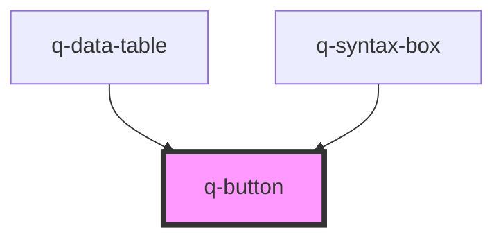

# q-button

<!-- Auto Generated Below -->

## Properties

| Property    | Attribute    | Description                                                                                     | Type                                                                     | Default     |
| ----------- | ------------ | ----------------------------------------------------------------------------------------------- | ------------------------------------------------------------------------ | ----------- |
| `ariaLabel` | `aria-label` | Accessible label forwarded to the inner button or anchor. Required for icon-only buttons.       | `string`                                                                 | `undefined` |
| `disabled`  | `disabled`   | Disables interaction and marks the control as unavailable.                                      | `boolean`                                                                | `false`     |
| `download`  | `download`   | Download filename or boolean download hint for link buttons.                                    | `string`                                                                 | `undefined` |
| `expand`    | `expand`     | Expands the button to fill its container width.                                                 | `boolean`                                                                | `false`     |
| `href`      | `href`       | URL to render the component as a link.                                                          | `string`                                                                 | `undefined` |
| `iconOnly`  | `icon-only`  | Renders compact icon-only spacing. When unset, this is auto-detected from slotted icon content. | `boolean`                                                                | `undefined` |
| `layout`    | `layout`     | Controls whether icon and label content flow inline or stack vertically.                        | `"inline" \| "stacked"`                                                  | `'inline'`  |
| `loading`   | `loading`    | Shows a spinner and suppresses interaction while work is in progress.                           | `boolean`                                                                | `false`     |
| `rel`       | `rel`        | Link rel value. Defaults to noopener noreferrer for target="_blank".                            | `string`                                                                 | `undefined` |
| `shape`     | `shape`      | Controls the button outline and fixed circular presentation.                                    | `"circle" \| "default" \| "pill"`                                        | `'default'` |
| `size`      | `size`       | Button size.                                                                                    | `"lg" \| "md" \| "sm"`                                                   | `'md'`      |
| `target`    | `target`     | Link target used when `href` is set.                                                            | `string`                                                                 | `undefined` |
| `type`      | `type`       | Native button type used when rendering a `<button>`.                                            | `"button" \| "reset" \| "submit"`                                        | `'button'`  |
| `variant`   | `variant`    | Visual style of the button.                                                                     | `"danger" \| "ghost" \| "primary" \| "secondary" \| "success" \| "text"` | `'primary'` |

## Events

| Event    | Description                                    | Type                      |
| -------- | ---------------------------------------------- | ------------------------- |
| `qBlur`  | Emitted when the inner control loses focus.    | `CustomEvent<FocusEvent>` |
| `qClick` | Emitted on click, unless disabled or loading.  | `CustomEvent<MouseEvent>` |
| `qFocus` | Emitted when the inner control receives focus. | `CustomEvent<FocusEvent>` |

## Shadow Parts

| Part        | Description |
| ----------- | ----------- |
| `"spinner"` |             |

## Dependencies

### Used by

 - [q-data-table](../../data-display/data-table)
 - [q-syntax-box](../../data-display/syntax-box)

### Graph

----------------------------------------------

*Built with [StencilJS](https://stenciljs.com/)*
