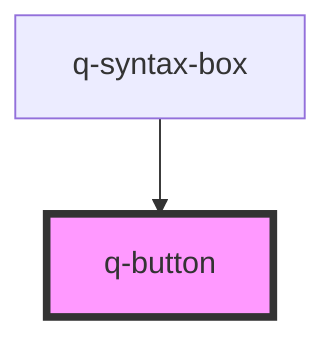

# q-button

<!-- Auto Generated Below -->

## Properties

| Property   | Attribute   | Description | Type                                                                     | Default     |
| ---------- | ----------- | ----------- | ------------------------------------------------------------------------ | ----------- |
| `disabled` | `disabled`  |             | `boolean`                                                                | `false`     |
| `download` | `download`  |             | `string`                                                                 | `undefined` |
| `expand`   | `expand`    |             | `boolean`                                                                | `false`     |
| `href`     | `href`      |             | `string`                                                                 | `undefined` |
| `iconOnly` | `icon-only` |             | `boolean`                                                                | `undefined` |
| `loading`  | `loading`   |             | `boolean`                                                                | `false`     |
| `size`     | `size`      |             | `"lg" \| "md" \| "sm"`                                                   | `'md'`      |
| `target`   | `target`    |             | `string`                                                                 | `undefined` |
| `type`     | `type`      |             | `"button" \| "reset" \| "submit"`                                        | `'button'`  |
| `variant`  | `variant`   |             | `"danger" \| "ghost" \| "primary" \| "secondary" \| "success" \| "text"` | `'primary'` |

## Events

| Event    | Description | Type                      |
| -------- | ----------- | ------------------------- |
| `qBlur`  |             | `CustomEvent<FocusEvent>` |
| `qClick` |             | `CustomEvent<MouseEvent>` |
| `qFocus` |             | `CustomEvent<FocusEvent>` |

## Shadow Parts

| Part        | Description |
| ----------- | ----------- |
| `"spinner"` |             |

## Dependencies

### Used by

 - [q-syntax-box](../syntax-box)

### Graph

----------------------------------------------

*Built with [StencilJS](https://stenciljs.com/)*
