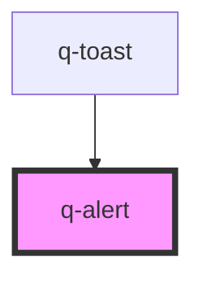

# q-alert

<!-- Auto Generated Below -->

## Overview

Inline contextual message with opt-in announcements and controlled dismissal.

## Properties

| Property       | Attribute       | Description                                                                    | Type                                           | Default           |
| -------------- | --------------- | ------------------------------------------------------------------------------ | ---------------------------------------------- | ----------------- |
| `announcement` | `announcement`  | Live-region behavior. Announcements are off by default to avoid noisy updates. | `"assertive" \| "off" \| "polite"`             | `'off'`           |
| `dismissLabel` | `dismiss-label` | Accessible label for the dismiss button.                                       | `string`                                       | `'Dismiss alert'` |
| `dismissible`  | `dismissible`   |                                                                                | `boolean`                                      | `false`           |
| `heading`      | `heading`       |                                                                                | `string`                                       | `undefined`       |
| `variant`      | `variant`       |                                                                                | `"danger" \| "info" \| "success" \| "warning"` | `'info'`          |

## Events

| Event      | Description                                     | Type                |
| ---------- | ----------------------------------------------- | ------------------- |
| `qDismiss` | The component remains rendered after dismissal. | `CustomEvent<void>` |

## Slots

| Slot        | Description                                           |
| ----------- | ----------------------------------------------------- |
|             | Alert message content.                                |
| `"actions"` | Optional action controls displayed after the message. |
| `"icon"`    | Optional leading icon or status mark.                 |

## Shadow Parts

| Part               | Description                   |
| ------------------ | ----------------------------- |
| `"actions"`        | Optional action region.       |
| `"container"`      | Outer alert container.        |
| `"content"`        | Heading and message region.   |
| `"dismiss-button"` | Native dismiss button.        |
| `"heading"`        | Optional alert heading.       |
| `"icon"`           | Leading icon region.          |
| `"message"`        | Default message slot wrapper. |

## Dependencies

### Used by

 - [q-toast](../../overlays/toast)

### Graph

----------------------------------------------

*Built with [StencilJS](https://stenciljs.com/)*
