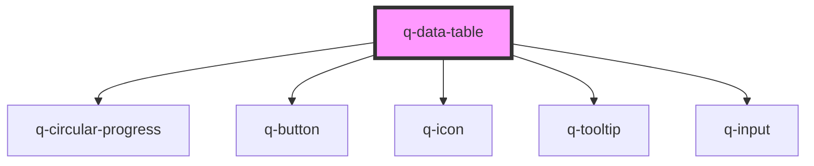

# q-data-table

## CSS Custom Properties

| Name                         | Description                                                    |
| ---------------------------- | -------------------------------------------------------------- |
| `--q-table-dropdown-bg`      | Background color forwarded to slotted q-dropdown controls.     |
| `--q-table-dropdown-border`  | Border style forwarded to slotted q-dropdown controls.         |
| `--q-table-dropdown-fg`      | Foreground color forwarded to slotted q-dropdown controls.     |
| `--q-table-dropdown-menu-bg` | Menu background color forwarded to slotted q-dropdown controls. |
| `--q-table-dropdown-primary` | Primary color forwarded to slotted q-dropdown controls.        |
| `--q-table-max-height`       | Maximum height for the scrollable table area.                  |

<!-- Auto Generated Below -->

## Overview

Data grid with optional toolbar, search, row activation, and multi-row selection.

## Properties

| Property            | Attribute            | Description                                                                                       | Type                               | Default       |
| ------------------- | -------------------- | ------------------------------------------------------------------------------------------------- | ---------------------------------- | ------------- |
| `columns`           | `columns`            | Column definitions, or a JSON string of column definitions.                                       | `TableColumn<unknown>[] \| string` | `[]`          |
| `items`             | `items`              | Row data, or a JSON string of row data.                                                           | `string \| unknown[]`              | `[]`          |
| `keyField`          | `key-field`          | Row field used as the stable selection and render key. Falls back to the row index.               | `string`                           | `'id'`        |
| `loading`           | `loading`            | Shows a loading state and suppresses row rendering while true.                                    | `boolean`                          | `false`       |
| `rowActions`        | `row-actions`        | Optional row-level actions rendered as trailing icon buttons.                                     | `DataTableRowAction[] \| string`   | `[]`          |
| `searchPlaceholder` | `search-placeholder` | Placeholder text for the built-in search input.                                                   | `string`                           | `'Search...'` |
| `searchValue`       | `search-value`       | Current search input value.                                                                       | `string`                           | `''`          |
| `selectable`        | `selectable`         | Enables row selection checkboxes and selection state.                                             | `boolean`                          | `false`       |
| `selectedKeys`      | --                   | Keys for currently selected rows.                                                                 | `unknown[]`                        | `[]`          |
| `showSearch`        | `show-search`        | Shows the built-in toolbar search input.                                                          | `boolean`                          | `false`       |
| `showToolbar`       | `show-toolbar`       | Shows the optional toolbar above the table.                                                       | `boolean`                          | `false`       |
| `sortColumn`        | `sort-column`        | Currently sorted column key.                                                                      | `string`                           | `undefined`   |
| `sortDirection`     | `sort-direction`     | Current sort direction for the sorted column.                                                     | `"asc" \| "desc"`                  | `undefined`   |
| `sortMode`          | `sort-mode`          | Sorting behavior: 'table' sorts provided items locally, while 'external' only emits sort changes. | `"external" \| "table"`            | `'table'`     |
| `sortable`          | `sortable`           | Enables sortable column headers. Columns can override this with their own sortable setting.       | `boolean`                          | `false`       |
| `toolbarTitle`      | `toolbar-title`      | Title text rendered in the toolbar.                                                               | `string`                           | `undefined`   |

## Events

| Event              | Description                                                                        | Type                                                    |
| ------------------ | ---------------------------------------------------------------------------------- | ------------------------------------------------------- |
| `qRowAction`       | Emitted when a row action button is clicked.                                       | `CustomEvent<QDataTableRowActionDetail<unknown>>`       |
| `qRowClick`        | Emitted when a non-interactive row area is clicked or activated with the keyboard. | `CustomEvent<QDataTableRowClickDetail<unknown>>`        |
| `qSearch`          | Emitted when the built-in search input value changes.                              | `CustomEvent<string>`                                   |
| `qSelectionChange` | Emitted when selected rows change.                                                 | `CustomEvent<QDataTableSelectionChangeDetail<unknown>>` |
| `qSortChange`      | Emitted when a sortable column header changes sort state.                          | `CustomEvent<QDataTableSortChangeDetail>`               |

## Slots

| Slot             | Description                                           |
| ---------------- | ----------------------------------------------------- |
| `"actions"`      | Action controls displayed in the right toolbar group. |
| `"empty"`        | Empty-state content shown when no rows are available. |
| `"filters"`      | Filter controls displayed in the left toolbar group.  |
| `"footer"`       | Footer content rendered below the scrollable table.   |
| `"toolbar-left"` | Content placed before the search and filters area.    |

## Dependencies

### Depends on

- [q-circular-progress](../../indicators/circular-progress)
- [q-button](../../actions/button)
- [q-icon](../../media/icon)
- [q-tooltip](../../overlays/tooltip)
- [q-input](../../inputs/input)

### Graph

----------------------------------------------

*Built with [StencilJS](https://stenciljs.com/)*
