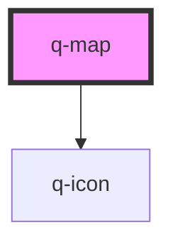

# q-map

`q-map` keeps the original dot/avatar marker API unchanged and adds optional rich presentation:

- `kind`: `dot`, `avatar`, or `icon`
- `ring` and `pulse`: independent status emphasis
- `badge`: compact icon/text status with a required accessible label
- `callout`: plain-text, non-interactive context shown always or only while selected
- `clusterMarkers`: deterministic, keyboard-accessible clustering

```ts
map.markers = [{
  id: 'location-1',
  latitude: -26.1459,
  longitude: 28.0416,
  label: 'Rosebank location, live',
  kind: 'avatar',
  fallbackText: 'RL',
  variant: 'success',
  ring: 'solid',
  pulse: true,
  badge: {
    icon: 'clock-3',
    variant: 'warning',
    ariaLabel: 'Location updated eight minutes ago',
  },
  callout: {
    title: 'Rosebank location',
    subtitle: 'Live now',
    meta: 'Updated eight minutes ago',
    placement: 'right',
  },
}];
```

Cancel `qClusterSelect` to replace the default centre-and-zoom behaviour. Callout and badge strings are inserted as text, never interpreted as HTML.


<!-- Auto Generated Below -->


## Overview

Framework-neutral interactive map powered by Leaflet.

## Properties

| Property             | Attribute              | Description                                                                                                   | Type                                                | Default             |
| -------------------- | ---------------------- | ------------------------------------------------------------------------------------------------------------- | --------------------------------------------------- | ------------------- |
| `ariaLabel`          | `aria-label`           | Provides the accessible name announced for the interactive map region.                                        | `string`                                            | `'Interactive map'` |
| `attribution`        | `attribution`          | Renders plain-text attribution whenever raster tiles or styled vectors are active.                            | `string`                                            | `''`                |
| `attributionUrl`     | `attribution-url`      | Links map attribution only when the value resolves to an HTTP(S) URL.                                         | `string`                                            | `''`                |
| `centerLatitude`     | `center-latitude`      | Controls viewport latitude; finite values are clamped to the geographic range.                                | `number`                                            | `0`                 |
| `centerLongitude`    | `center-longitude`     | Controls viewport longitude; finite values are clamped to the geographic range.                               | `number`                                            | `0`                 |
| `clusterMarkers`     | `cluster-markers`      | Groups nearby markers while preserving their stable source IDs.                                               | `boolean`                                           | `false`             |
| `clusterMaxZoom`     | `cluster-max-zoom`     | Sets the last zoom level where clusters may remain; defaults to one below maxZoom.                            | `number`                                            | `undefined`         |
| `clusterMinPoints`   | `cluster-min-points`   | Sets the minimum number of nearby markers needed to form a cluster.                                           | `number`                                            | `2`                 |
| `clusterRadius`      | `cluster-radius`       | Sets the clustering radius in screen pixels and is clamped from 1 to 200.                                     | `number`                                            | `48`                |
| `googleApiKey`       | `google-api-key`       | Supplies the browser-restricted key used only when WebQuark must load Google Maps.                            | `string`                                            | `''`                |
| `googleMapType`      | `google-map-type`      | Chooses the Google base-map style, normalizing unsupported values to roadmap.                                 | `"hybrid" \| "roadmap" \| "satellite" \| "terrain"` | `'roadmap'`         |
| `markers`            | `markers`              | Reconciles marker records from an array or JSON string using type-stable IDs.                                 | `QMapMarker[] \| string`                            | `[]`                |
| `maxBounds`          | `max-bounds`           | Constrains panning from a bounds object or JSON string; malformed updates preserve the last valid boundary.   | `QMapBounds \| string`                              | `undefined`         |
| `maxBoundsViscosity` | `max-bounds-viscosity` | Controls drag resistance at maxBounds and is clamped from zero to one.                                        | `number`                                            | `1`                 |
| `maxZoom`            | `max-zoom`             | Sets the highest permitted zoom and never resolves below minZoom.                                             | `number`                                            | `19`                |
| `minZoom`            | `min-zoom`             | Sets the lowest permitted zoom; non-finite values normalize to zero.                                          | `number`                                            | `0`                 |
| `provider`           | `provider`             | Selects raster tiles, styled vector data, or Google imagery; non-tile failures may use tileUrl as a fallback. | `"google" \| "tiles" \| "vector"`                   | `'tiles'`           |
| `selectedMarkerId`   | `selected-marker-id`   | Controls which marker exposes its selected visual and aria-pressed state.                                     | `number \| string`                                  | `undefined`         |
| `tileUrl`            | `tile-url`             | Supplies the tile URL template for the tiles provider and optional vector/Google fallback.                    | `string`                                            | `''`                |
| `vectorStyleUrl`     | `vector-style-url`     | Supplies a MapLibre Style Specification URL for the vector provider.                                          | `string`                                            | `''`                |
| `zoom`               | `zoom`                 | Controls the viewport zoom and is clamped between the normalized zoom limits.                                 | `number`                                            | `2`                 |
| `zoomControls`       | `zoom-controls`        | Controls whether the built-in plus/minus zoom control is rendered.                                            | `boolean`                                           | `true`              |


## Events

| Event            | Description                                                                     | Type                                   |
| ---------------- | ------------------------------------------------------------------------------- | -------------------------------------- |
| `qClusterSelect` | Reports cluster activation before the default centre-and-zoom action.           | `CustomEvent<QMapClusterSelectDetail>` |
| `qError`         | Reports serializable configuration and initialization failures.                 | `CustomEvent<QMapErrorDetail>`         |
| `qMarkerSelect`  | Reports marker activation without mutating selectedMarkerId.                    | `CustomEvent<QMapMarkerSelectDetail>`  |
| `qReady`         | Fires after Leaflet setup and the initial provider attempt complete.            | `CustomEvent<void>`                    |
| `qStatusChange`  | Reports provider lifecycle transitions, including the active fallback provider. | `CustomEvent<QMapStatusChangeDetail>`  |


## Slots

| Slot      | Description                                                                  |
| --------- | ---------------------------------------------------------------------------- |
| `"empty"` | Content shown when the requested provider is missing required configuration. |
| `"error"` | Content shown after provider initialization fails without a usable fallback. |


## Shadow Parts

| Part               | Description                                  |
| ------------------ | -------------------------------------------- |
| `"attribution"`    | Provider attribution text or link.           |
| `"canvas"`         | Leaflet map canvas.                          |
| `"cluster"`        | Each interactive marker cluster.             |
| `"empty"`          | Missing-configuration overlay.               |
| `"error"`          | Provider-error overlay.                      |
| `"marker"`         | Each interactive map marker.                 |
| `"marker-badge"`   | A marker's optional status badge.            |
| `"marker-callout"` | A marker's optional non-interactive callout. |
| `"surface"`        | Outer clipped map surface.                   |


## Dependencies

### Depends on

- [q-icon](../../media/icon)

### Graph


----------------------------------------------

*Built with [StencilJS](https://stenciljs.com/)*
