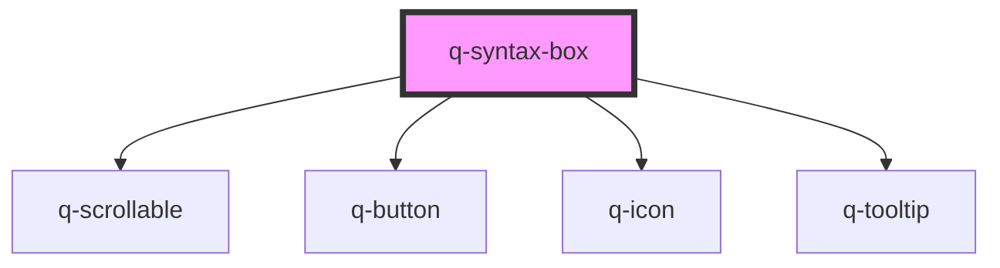

# q-syntax-box

<!-- Auto Generated Below -->

## Overview

Displays and optionally edits syntax-highlighted code, with form association in editable mode.

## Properties

| Property   | Attribute  | Description                                                                                              | Type                                        | Default     |
| ---------- | ---------- | -------------------------------------------------------------------------------------------------------- | ------------------------------------------- | ----------- |
| `code`     | `code`     | Code content to display or edit. Kept in sync with `value`; prefer `code` for domain usage.              | `string`                                    | `undefined` |
| `copyable` | `copyable` | Shows a copy action in the panel header.                                                                 | `boolean`                                   | `false`     |
| `disabled` | `disabled` | Disables editing and panel actions.                                                                      | `boolean`                                   | `false`     |
| `editable` | `editable` | Enables the editable textarea overlay.                                                                   | `boolean`                                   | `false`     |
| `heading`  | `heading`  | Optional header text shown in the panel variant.                                                         | `string`                                    | `undefined` |
| `height`   | `height`   | Explicit content height. Panel mode defaults to 110px; plain mode defaults to auto.                      | `string`                                    | `undefined` |
| `language` | `language` | Syntax language used for highlighting and formatting.                                                    | `"css" \| "html" \| "javascript" \| "json"` | `'html'`    |
| `name`     | `name`     | Form field name used when the component is editable.                                                     | `string`                                    | `undefined` |
| `required` | `required` | Marks the editable textarea as required for form validation.                                             | `boolean`                                   | `false`     |
| `value`    | `value`    | Form value alias for `code`. Set either `code` or `value`; the component mirrors them for compatibility. | `string`                                    | `undefined` |
| `variant`  | `variant`  | Visual presentation for the code box.                                                                    | `"panel" \| "plain"`                        | `'panel'`   |

## Events

| Event     | Description                                                                             | Type                  |
| --------- | --------------------------------------------------------------------------------------- | --------------------- |
| `qChange` | Emitted when editable content is committed by the native change event or by formatting. | `CustomEvent<string>` |
| `qInput`  | Emitted on each editable content input and after formatting.                            | `CustomEvent<string>` |

## Methods

### `scrollToBottom() => Promise<void>`

Programmatically scrolls the read-only code body to the bottom when it is wrapped by q-scrollable.

#### Returns

Type: `Promise<void>`

## Slots

| Slot        | Description                                            |
| ----------- | ------------------------------------------------------ |
|             | Fallback content rendered when `code` is not provided. |
| `"actions"` | Additional actions rendered in the panel header.       |

## Dependencies

### Depends on

- [q-scrollable](../../layout/scrollable)
- [q-button](../../actions/button)
- [q-icon](../../media/icon)
- [q-tooltip](../../overlays/tooltip)

### Graph

----------------------------------------------

*Built with [StencilJS](https://stenciljs.com/)*
