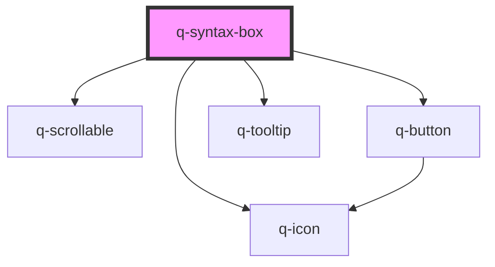

# q-syntax-box

<!-- Auto Generated Below -->

## Overview

Displays and optionally edits syntax-highlighted code, with form association in editable mode.

## Properties

| Property    | Attribute    | Description                                                                         | Type                                        | Default     |
| ----------- | ------------ | ----------------------------------------------------------------------------------- | ------------------------------------------- | ----------- |
| `ariaLabel` | `aria-label` | Accessible name for the editor; falls back to `heading`, then the language.         | `string`                                    | `null`      |
| `code`      | `code`       | Mirrored with `value`; prefer `code` for domain usage.                              | `string`                                    | `undefined` |
| `copyable`  | `copyable`   |                                                                                     | `boolean`                                   | `false`     |
| `disabled`  | `disabled`   | Disables editing and panel actions.                                                 | `boolean`                                   | `false`     |
| `editable`  | `editable`   |                                                                                     | `boolean`                                   | `false`     |
| `heading`   | `heading`    | Shown only in the panel variant.                                                    | `string`                                    | `undefined` |
| `height`    | `height`     | Explicit content height. Panel mode defaults to 110px; plain mode defaults to auto. | `string`                                    | `undefined` |
| `language`  | `language`   |                                                                                     | `"css" \| "html" \| "javascript" \| "json"` | `'html'`    |
| `name`      | `name`       | Form field name used when the component is editable.                                | `string`                                    | `undefined` |
| `required`  | `required`   | Marks the editable textarea as required for form validation.                        | `boolean`                                   | `false`     |
| `value`     | `value`      | Form-value alias mirrored with `code` for compatibility.                            | `string`                                    | `undefined` |
| `variant`   | `variant`    |                                                                                     | `"panel" \| "plain"`                        | `'panel'`   |

## Events

| Event     | Description                                                                             | Type                  |
| --------- | --------------------------------------------------------------------------------------- | --------------------- |
| `qChange` | Emitted when editable content is committed by the native change event or by formatting. | `CustomEvent<string>` |
| `qInput`  | Emitted on each editable content input and after formatting.                            | `CustomEvent<string>` |

## Methods

### `checkValidity() => Promise<boolean>`

Returns whether editable content satisfies native constraints.

#### Returns

Type: `Promise<boolean>`

### `reportValidity() => Promise<boolean>`

Reports editable constraint violations and returns whether the control is valid.

#### Returns

Type: `Promise<boolean>`

### `scrollToBottom() => Promise<void>`

Programmatically scrolls the read-only code body to the bottom when it is wrapped by q-scrollable.

#### Returns

Type: `Promise<void>`

## Slots

| Slot        | Description                                            |
| ----------- | ------------------------------------------------------ |
|             | Fallback content rendered when `code` is not provided. |
| `"actions"` | Additional actions rendered in the panel header.       |

## Dependencies

### Depends on

- [q-scrollable](../../layout/scrollable)
- [q-button](../../actions/button)
- [q-icon](../../media/icon)
- [q-tooltip](../../overlays/tooltip)

### Graph

----------------------------------------------

*Built with [StencilJS](https://stenciljs.com/)*
