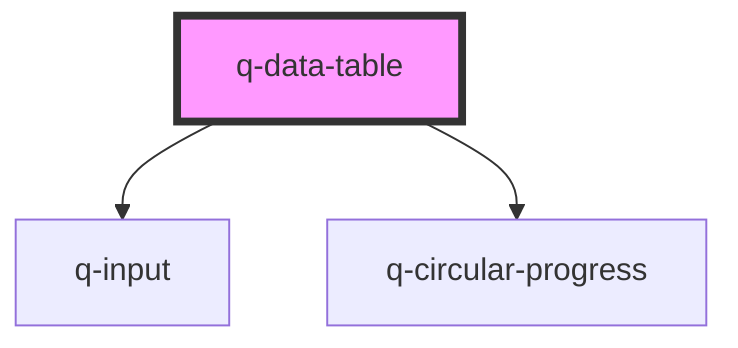

# q-data-table

<!-- Auto Generated Below -->

## Properties

| Property            | Attribute            | Description | Type                      | Default       |
| ------------------- | -------------------- | ----------- | ------------------------- | ------------- |
| `columns`           | `columns`            |             | `TableColumn[] \| string` | `[]`          |
| `items`             | `items`              |             | `any[] \| string`         | `[]`          |
| `keyField`          | `key-field`          |             | `string`                  | `'id'`        |
| `loading`           | `loading`            |             | `boolean`                 | `false`       |
| `searchPlaceholder` | `search-placeholder` |             | `string`                  | `'Search...'` |
| `searchValue`       | `search-value`       |             | `string`                  | `''`          |
| `selectable`        | `selectable`         |             | `boolean`                 | `false`       |
| `selectedKeys`      | --                   |             | `any[]`                   | `[]`          |
| `showSearch`        | `show-search`        |             | `boolean`                 | `false`       |
| `showToolbar`       | `show-toolbar`       |             | `boolean`                 | `false`       |
| `toolbarTitle`      | `toolbar-title`      |             | `string`                  | `undefined`   |

## Events

| Event              | Description | Type                                                                                     |
| ------------------ | ----------- | ---------------------------------------------------------------------------------------- |
| `qRowClick`        |             | `CustomEvent<{ item: any; index: number; originalEvent: KeyboardEvent \| MouseEvent; }>` |
| `qSearch`          |             | `CustomEvent<string>`                                                                    |
| `qSelectionChange` |             | `CustomEvent<{ selectedKeys: any[]; selectedItems: any[]; }>`                            |

## Dependencies

### Depends on

- [q-input](../input)
- [q-circular-progress](../circular-progress)

### Graph

----------------------------------------------

*Built with [StencilJS](https://stenciljs.com/)*
