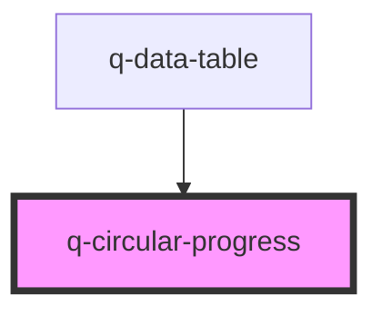

# q-circular-progress

<!-- Auto Generated Below -->

## Properties

| Property        | Attribute       | Description | Type                   | Default     |
| --------------- | --------------- | ----------- | ---------------------- | ----------- |
| `indeterminate` | `indeterminate` |             | `boolean`              | `false`     |
| `label`         | `label`         |             | `string`               | `undefined` |
| `size`          | `size`          |             | `"lg" \| "md" \| "sm"` | `'md'`      |
| `value`         | `value`         |             | `number`               | `0`         |

## Dependencies

### Used by

 - [q-data-table](../../data-display/data-table)

### Graph

----------------------------------------------

*Built with [StencilJS](https://stenciljs.com/)*
