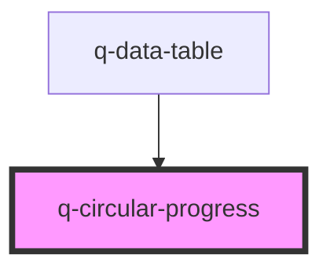

# q-circular-progress

<!-- Auto Generated Below -->

## Overview

Circular progress indicator for determinate percentages or indeterminate loading states.

## Properties

| Property        | Attribute       | Description                                                               | Type                   | Default     |
| --------------- | --------------- | ------------------------------------------------------------------------- | ---------------------- | ----------- |
| `ariaLabel`     | `aria-label`    | Accessible name for the progressbar.                                      | `string`               | `undefined` |
| `indeterminate` | `indeterminate` | Shows a spinning indeterminate state instead of a fixed progress value.   | `boolean`              | `false`     |
| `label`         | `label`         | Optional visible center text. Defaults to the clamped percentage.         | `string`               | `undefined` |
| `size`          | `size`          | Visual size preset for the SVG, stroke width, and label text.             | `"lg" \| "md" \| "sm"` | `'md'`      |
| `value`         | `value`         | Progress percentage from 0 to 100; values outside that range are clamped. | `number`               | `0`         |

## Dependencies

### Used by

 - [q-data-table](../../data-display/data-table)

### Graph

----------------------------------------------

*Built with [StencilJS](https://stenciljs.com/)*
