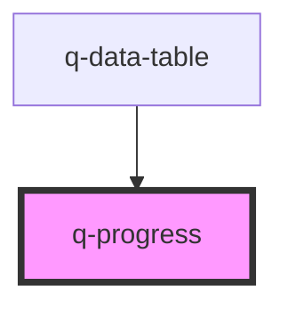

# q-progress

<!-- Auto Generated Below -->

## Overview

Progress indicator with linear and circular presentation variants.

## Properties

| Property        | Attribute        | Description                                                               | Type                                                           | Default     |
| --------------- | ---------------- | ------------------------------------------------------------------------- | -------------------------------------------------------------- | ----------- |
| `ariaLabel`     | `aria-label`     | Accessible name for the progressbar.                                      | `string`                                                       | `null`      |
| `ariaValueText` | `aria-valuetext` | Optional accessible value description, such as "2 of 6 tasks completed".  | `string`                                                       | `null`      |
| `indeterminate` | `indeterminate`  | Shows an indeterminate animation instead of a fixed progress value.       | `boolean`                                                      | `false`     |
| `label`         | `label`          | Optional visible circular label. Defaults to the clamped percentage.      | `string`                                                       | `undefined` |
| `size`          | `size`           | Visual size preset. Numeric values set a custom pixel size or height.     | `"lg" \| "md" \| "sm" \| number`                               | `'md'`      |
| `tone`          | `tone`           | Semantic color applied to the progress fill.                              | `"danger" \| "neutral" \| "primary" \| "success" \| "warning"` | `'primary'` |
| `value`         | `value`          | Progress percentage from 0 to 100; values outside that range are clamped. | `number`                                                       | `0`         |
| `variant`       | `variant`        | Visual presentation of the progress indicator.                            | `"circular" \| "linear"`                                       | `'linear'`  |

## Shadow Parts

| Part          | Description                                     |
| ------------- | ----------------------------------------------- |
| `"container"` | The element carrying progressbar semantics.     |
| `"fill"`      | The determinate or indeterminate progress fill. |
| `"label"`     | The visible circular progress label.            |
| `"track"`     | The inactive progress track.                    |

## Dependencies

### Used by

 - [q-data-table](../../data-display/data-table)

### Graph

----------------------------------------------

*Built with [StencilJS](https://stenciljs.com/)*
