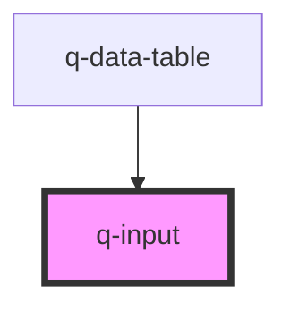

# q-input

<!-- Auto Generated Below -->

## Properties

| Property       | Attribute       | Description | Type                                                                          | Default     |
| -------------- | --------------- | ----------- | ----------------------------------------------------------------------------- | ----------- |
| `clearable`    | `clearable`     |             | `boolean`                                                                     | `false`     |
| `disabled`     | `disabled`      |             | `boolean`                                                                     | `false`     |
| `error`        | `error`         |             | `string`                                                                      | `undefined` |
| `errorMessage` | `error-message` |             | `string`                                                                      | `undefined` |
| `label`        | `label`         |             | `string`                                                                      | `undefined` |
| `max`          | `max`           |             | `number`                                                                      | `undefined` |
| `min`          | `min`           |             | `number`                                                                      | `undefined` |
| `placeholder`  | `placeholder`   |             | `string`                                                                      | `""`        |
| `required`     | `required`      |             | `boolean`                                                                     | `false`     |
| `size`         | `size`          |             | `"lg" \| "md" \| "sm"`                                                        | `'md'`      |
| `step`         | `step`          |             | `number`                                                                      | `1`         |
| `type`         | `type`          |             | `"color" \| "email" \| "number" \| "password" \| "search" \| "text" \| "url"` | `'text'`    |
| `value`        | `value`         |             | `string`                                                                      | `""`        |

## Events

| Event     | Description | Type                      |
| --------- | ----------- | ------------------------- |
| `qBlur`   |             | `CustomEvent<FocusEvent>` |
| `qChange` |             | `CustomEvent<string>`     |
| `qFocus`  |             | `CustomEvent<FocusEvent>` |
| `qInput`  |             | `CustomEvent<string>`     |

## Methods

### `clearValue() => Promise<void>`

#### Returns

Type: `Promise<void>`

### `focusElement() => Promise<void>`

#### Returns

Type: `Promise<void>`

## Shadow Parts

| Part          | Description |
| ------------- | ----------- |
| `"control"`   |             |
| `"error-msg"` |             |
| `"label"`     |             |
| `"prefix"`    |             |
| `"spinners"`  |             |
| `"suffix"`    |             |

## Dependencies

### Used by

 - [q-data-table](../data-table)

### Graph

----------------------------------------------

*Built with [StencilJS](https://stenciljs.com/)*
