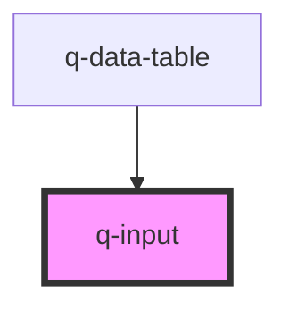

# q-input

<!-- Auto Generated Below -->

## Overview

Form-associated input field with optional prefix/suffix slots, clear button, password visibility toggle, and numeric spinner controls.

## Properties

| Property       | Attribute       | Description                                                                            | Type                                                                          | Default     |
| -------------- | --------------- | -------------------------------------------------------------------------------------- | ----------------------------------------------------------------------------- | ----------- |
| `clearable`    | `clearable`     | Shows a clear button when the field has a value.                                       | `boolean`                                                                     | `false`     |
| `disabled`     | `disabled`      | Disables input interaction.                                                            | `boolean`                                                                     | `false`     |
| `error`        | `error`         | Validation error text or error-state flag.                                             | `string`                                                                      | `undefined` |
| `errorMessage` | `error-message` | Validation helper text displayed when the field is in an error state.                  | `string`                                                                      | `undefined` |
| `label`        | `label`         | Optional label rendered above the input.                                               | `string`                                                                      | `undefined` |
| `max`          | `max`           | Maximum numeric value for number inputs.                                               | `number`                                                                      | `undefined` |
| `min`          | `min`           | Minimum numeric value for number inputs.                                               | `number`                                                                      | `undefined` |
| `name`         | `name`          | Native form field name.                                                                | `string`                                                                      | `undefined` |
| `placeholder`  | `placeholder`   | Placeholder text shown when the field is empty.                                        | `string`                                                                      | `""`        |
| `required`     | `required`      | Marks the field as required for native forms.                                          | `boolean`                                                                     | `false`     |
| `size`         | `size`          | Visual size preset.                                                                    | `"lg" \| "md" \| "sm"`                                                        | `'md'`      |
| `step`         | `step`          | Numeric increment/decrement step.                                                      | `number`                                                                      | `1`         |
| `type`         | `type`          | Native input type; password adds a visibility toggle and number adds spinner controls. | `"color" \| "email" \| "number" \| "password" \| "search" \| "text" \| "url"` | `'text'`    |
| `value`        | `value`         | Current input value.                                                                   | `string`                                                                      | `""`        |

## Events

| Event     | Description                                                     | Type                      |
| --------- | --------------------------------------------------------------- | ------------------------- |
| `qBlur`   | Emitted when the native input loses focus.                      | `CustomEvent<FocusEvent>` |
| `qChange` | Emitted when the committed value changes.                       | `CustomEvent<string>`     |
| `qClick`  | Emitted when the native input is clicked.                       | `CustomEvent<MouseEvent>` |
| `qFocus`  | Emitted when the native input receives focus.                   | `CustomEvent<FocusEvent>` |
| `qInput`  | Emitted as the user types or spinner controls update the value. | `CustomEvent<string>`     |

## Methods

### `clearValue() => Promise<void>`

Clears the current value and focuses the native input.

#### Returns

Type: `Promise<void>`

### `focusElement() => Promise<void>`

Moves focus to the native input.

#### Returns

Type: `Promise<void>`

## Slots

| Slot       | Description                                                                                  |
| ---------- | -------------------------------------------------------------------------------------------- |
| `"prefix"` | Content displayed before the native input.                                                   |
| `"suffix"` | Content displayed after the native input when no clear or password toggle button is visible. |

## Shadow Parts

| Part          | Description                                          |
| ------------- | ---------------------------------------------------- |
| `"control"`   | Wrapper around the native input and inline controls. |
| `"error-msg"` | Validation helper text.                              |
| `"label"`     | Optional field label.                                |
| `"prefix"`    | Prefix slot container.                               |
| `"spinners"`  | Numeric spinner button container.                    |
| `"suffix"`    | Suffix slot container.                               |

## Dependencies

### Used by

 - [q-data-table](../../data-display/data-table)

### Graph

----------------------------------------------

*Built with [StencilJS](https://stenciljs.com/)*
