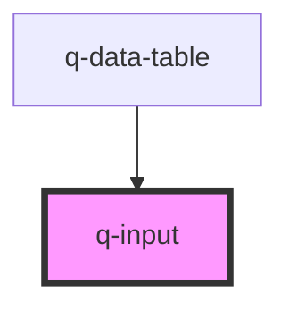

# q-input

<!-- Auto Generated Below -->

## Overview

Form-associated input field with optional prefix/suffix slots, clear button, password visibility toggle, and numeric spinner controls.

## Properties

| Property       | Attribute       | Description                                                            | Type                                                                          | Default     |
| -------------- | --------------- | ---------------------------------------------------------------------- | ----------------------------------------------------------------------------- | ----------- |
| `ariaLabel`    | `aria-label`    | Accessible name for the native input when a visible label is not used. | `string`                                                                      | `null`      |
| `clearable`    | `clearable`     | Shows a clear button when the field has a value.                       | `boolean`                                                                     | `false`     |
| `disabled`     | `disabled`      |                                                                        | `boolean`                                                                     | `false`     |
| `error`        | `error`         | Validation error text or error-state flag.                             | `string`                                                                      | `undefined` |
| `errorMessage` | `error-message` | Validation helper text displayed when the field is in an error state.  | `string`                                                                      | `undefined` |
| `label`        | `label`         |                                                                        | `string`                                                                      | `undefined` |
| `max`          | `max`           |                                                                        | `number`                                                                      | `undefined` |
| `min`          | `min`           |                                                                        | `number`                                                                      | `undefined` |
| `name`         | `name`          |                                                                        | `string`                                                                      | `undefined` |
| `placeholder`  | `placeholder`   |                                                                        | `string`                                                                      | `""`        |
| `required`     | `required`      |                                                                        | `boolean`                                                                     | `false`     |
| `size`         | `size`          |                                                                        | `"lg" \| "md" \| "sm"`                                                        | `'md'`      |
| `step`         | `step`          |                                                                        | `number`                                                                      | `1`         |
| `type`         | `type`          | `password` adds a visibility toggle; `number` adds spinner controls.   | `"color" \| "email" \| "number" \| "password" \| "search" \| "text" \| "url"` | `'text'`    |
| `value`        | `value`         |                                                                        | `string`                                                                      | `""`        |

## Events

| Event     | Description                                                     | Type                      |
| --------- | --------------------------------------------------------------- | ------------------------- |
| `qBlur`   |                                                                 | `CustomEvent<FocusEvent>` |
| `qChange` | Emitted when the committed value changes.                       | `CustomEvent<string>`     |
| `qClick`  |                                                                 | `CustomEvent<MouseEvent>` |
| `qFocus`  |                                                                 | `CustomEvent<FocusEvent>` |
| `qInput`  | Emitted as the user types or spinner controls update the value. | `CustomEvent<string>`     |

## Methods

### `checkValidity() => Promise<boolean>`

Returns whether the control satisfies native and custom constraints.

#### Returns

Type: `Promise<boolean>`

### `clearValue() => Promise<void>`

Clears the current value and focuses the native input.

#### Returns

Type: `Promise<void>`

### `focusElement() => Promise<void>`

Moves focus to the native input.

#### Returns

Type: `Promise<void>`

### `reportValidity() => Promise<boolean>`

Reports native or custom constraint violations and returns whether the control is valid.

#### Returns

Type: `Promise<boolean>`

## Slots

| Slot       | Description                                                                                  |
| ---------- | -------------------------------------------------------------------------------------------- |
| `"prefix"` | Content displayed before the native input.                                                   |
| `"suffix"` | Content displayed after the native input when no clear or password toggle button is visible. |

## Shadow Parts

| Part          | Description                                          |
| ------------- | ---------------------------------------------------- |
| `"control"`   | Wrapper around the native input and inline controls. |
| `"error-msg"` | Validation helper text.                              |
| `"label"`     | Optional field label.                                |
| `"prefix"`    | Prefix slot container.                               |
| `"spinners"`  | Numeric spinner button container.                    |
| `"suffix"`    | Suffix slot container.                               |

## Dependencies

### Used by

 - [q-data-table](../../data-display/data-table)

### Graph

----------------------------------------------

*Built with [StencilJS](https://stenciljs.com/)*
