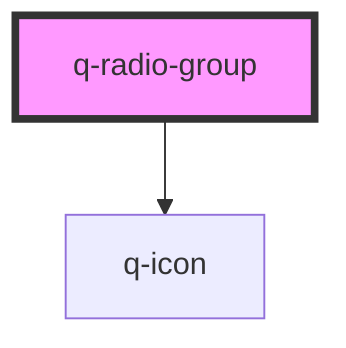

# q-radio-group

<!-- Auto Generated Below -->

## Overview

Form-associated single-selection radio group with a connected segmented presentation.

## Properties

| Property       | Attribute       | Description                                                           | Type                                         | Default        |
| -------------- | --------------- | --------------------------------------------------------------------- | -------------------------------------------- | -------------- |
| `ariaLabel`    | `aria-label`    | Accessible group name used when no visible label is supplied.         | `string`                                     | `null`         |
| `disabled`     | `disabled`      |                                                                       | `boolean`                                    | `false`        |
| `error`        | `error`         | Validation error text or error-state flag.                            | `string`                                     | `undefined`    |
| `errorMessage` | `error-message` | Validation helper text displayed when the group is in an error state. | `string`                                     | `undefined`    |
| `label`        | `label`         |                                                                       | `string`                                     | `undefined`    |
| `name`         | `name`          |                                                                       | `string`                                     | `undefined`    |
| `options`      | `options`       | Options to render; strings use the same text for label and value.     | `RadioGroupOptionInput[] \| string`          | `[]`           |
| `orientation`  | `orientation`   | `responsive` stacks the connected options below 680px.                | `"horizontal" \| "responsive" \| "vertical"` | `'responsive'` |
| `required`     | `required`      |                                                                       | `boolean`                                    | `false`        |
| `size`         | `size`          |                                                                       | `"lg" \| "md" \| "sm"`                       | `'md'`         |
| `value`        | `value`         |                                                                       | `string`                                     | `''`           |

## Events

| Event     | Description                                                    | Type                      |
| --------- | -------------------------------------------------------------- | ------------------------- |
| `qBlur`   |                                                                | `CustomEvent<FocusEvent>` |
| `qChange` | Emitted with the selected option value when selection changes. | `CustomEvent<string>`     |
| `qFocus`  |                                                                | `CustomEvent<FocusEvent>` |

## Methods

### `checkValidity() => Promise<boolean>`

Returns whether the group satisfies its required and custom-error constraints.

#### Returns

Type: `Promise<boolean>`

### `focusElement() => Promise<void>`

Focuses the selected option, or the first enabled option when nothing is selected.

#### Returns

Type: `Promise<void>`

### `reportValidity() => Promise<boolean>`

Reports group validity and returns whether the current selection is valid.

#### Returns

Type: `Promise<boolean>`

## Shadow Parts

| Part             | Description                                                          |
| ---------------- | -------------------------------------------------------------------- |
| `"error-msg"`    | Validation helper text.                                              |
| `"group"`        | Native fieldset that owns the radio-group semantics.                 |
| `"input"`        | Native radio input retained for keyboard and screen-reader behavior. |
| `"label"`        | Visible group legend.                                                |
| `"option"`       | Individual option label.                                             |
| `"option-icon"`  |                                                                      |
| `"option-label"` | Visible option text.                                                 |
| `"options"`      | Segmented option container.                                          |

## Dependencies

### Depends on

- [q-icon](../../media/icon)

### Graph

----------------------------------------------

*Built with [StencilJS](https://stenciljs.com/)*
