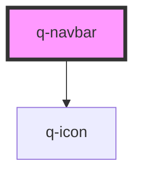

# q-navbar

## Item add-ons

Set `addonSlot` on a navigation item, then assign any custom element to that named slot. Use `addonPlacement` to position it at `top-start`, `top-center`, `top-end`, `bottom-start`, `bottom-center`, or `bottom-end`.

```html
<q-navbar id="app-navigation">
  <span slot="messages-addon">3</span>
</q-navbar>

<script>
  document.querySelector('#app-navigation').items = [
    {
      label: 'Messages',
      value: 'messages',
      addonSlot: 'messages-addon',
      addonPlacement: 'top-end'
    }
  ];
</script>
```

## CSS Custom Properties

| Name                    | Description                                                        |
| ----------------------- | ------------------------------------------------------------------ |
| `--q-navbar-item-width` | Width of each navigation item wrapper and interactive item. |


<!-- Auto Generated Below -->


## Overview

Edge-aware site navigation with optional brand content, actions, and mobile menu.

## Properties

| Property      | Attribute      | Description                                                                                                    | Type                                     | Default     |
| ------------- | -------------- | -------------------------------------------------------------------------------------------------------------- | ---------------------------------------- | ----------- |
| `activeValue` | `active-value` | Matches either an item's value or `href`.                                                                      | `string`                                 | `''`        |
| `ariaLabel`   | `aria-label`   | Accessible name for the desktop and mobile navigation regions.                                                 | `string`                                 | `null`      |
| `bordered`    | `bordered`     |                                                                                                                | `boolean`                                | `true`      |
| `brand`       | `brand`        |                                                                                                                | `string`                                 | `undefined` |
| `brandHref`   | `brand-href`   |                                                                                                                | `string`                                 | `'/'`       |
| `compact`     | `compact`      |                                                                                                                | `boolean`                                | `false`     |
| `edge`        | `edge`         |                                                                                                                | `"bottom" \| "left" \| "right" \| "top"` | `'top'`     |
| `items`       | `items`        | Navigation items; strings use the same text for label and value, while objects enable links, icons, and state. | `NavbarItemInput[] \| string`            | `[]`        |
| `logoAlt`     | `logo-alt`     | Accessible text for a logo-only brand image.                                                                   | `string`                                 | `''`        |
| `logoSrc`     | `logo-src`     |                                                                                                                | `string`                                 | `undefined` |
| `mobileLabel` | `mobile-label` | Accessible label for the mobile menu toggle button.                                                            | `string`                                 | `'Menu'`    |
| `mobileMode`  | `mobile-mode`  | Controls whether mobile widths collapse items into a menu or keep them inline.                                 | `"inline" \| "menu"`                     | `'menu'`    |
| `sticky`      | `sticky`       |                                                                                                                | `boolean`                                | `false`     |
| `transparent` | `transparent`  |                                                                                                                | `boolean`                                | `false`     |


## Events

| Event         | Description | Type                              |
| ------------- | ----------- | --------------------------------- |
| `qMenuToggle` |             | `CustomEvent<boolean>`            |
| `qSelect`     |             | `CustomEvent<NavbarSelectDetail>` |


## Slots

| Slot               | Description                        |
| ------------------ | ---------------------------------- |
| `"actions"`        | Desktop action controls.           |
| `"brand"`          | Custom brand link content.         |
| `"mobile-actions"` | Mobile action controls.            |
| `"mobile-nav"`     | Custom mobile navigation content.  |
| `"nav"`            | Custom desktop navigation content. |


## Shadow Parts

| Part             | Description                        |
| ---------------- | ---------------------------------- |
| `"actions"`      | Desktop action container.          |
| `"brand"`        | Brand link.                        |
| `"item-addon"`   | Per-item slotted add-on container. |
| `"menu-button"`  | Mobile menu toggle button.         |
| `"mobile-panel"` | Mobile menu panel.                 |
| `"nav"`          | Desktop navigation container.      |
| `"navbar"`       | Navbar container.                  |


## Dependencies

### Depends on

- [q-icon](../../media/icon)

### Graph


----------------------------------------------

*Built with [StencilJS](https://stenciljs.com/)*
