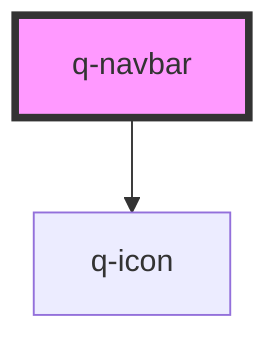

# q-navbar

<!-- Auto Generated Below -->

## Overview

Edge-aware site navigation with optional brand content, actions, and mobile menu.

## Properties

| Property      | Attribute      | Description                                                                    | Type                                     | Default     |
| ------------- | -------------- | ------------------------------------------------------------------------------ | ---------------------------------------- | ----------- |
| `activeValue` | `active-value` | Value or href of the currently active navigation item.                         | `string`                                 | `''`        |
| `bordered`    | `bordered`     | Renders a border along the inward-facing edge.                                 | `boolean`                                | `true`      |
| `brand`       | `brand`        | Brand text rendered inside the brand link.                                     | `string`                                 | `undefined` |
| `brandHref`   | `brand-href`   | URL used by the brand link.                                                    | `string`                                 | `'/'`       |
| `compact`     | `compact`      | Uses the compact navbar height and padding.                                    | `boolean`                                | `false`     |
| `edge`        | `edge`         | Edge the navbar is arranged against.                                           | `"bottom" \| "left" \| "right" \| "top"` | `'top'`     |
| `items`       | `items`        | Navigation items rendered in the desktop and mobile menus.                     | `NavbarItem[] \| string`                 | `[]`        |
| `logoAlt`     | `logo-alt`     | Accessible text for a logo-only brand image.                                   | `string`                                 | `''`        |
| `logoSrc`     | `logo-src`     | Brand logo image URL.                                                          | `string`                                 | `undefined` |
| `mobileLabel` | `mobile-label` | Accessible label for the mobile menu toggle button.                            | `string`                                 | `'Menu'`    |
| `mobileMode`  | `mobile-mode`  | Controls whether mobile widths collapse items into a menu or keep them inline. | `"inline" \| "menu"`                     | `'menu'`    |
| `sticky`      | `sticky`       | Keeps the navbar pinned to its configured edge.                                | `boolean`                                | `false`     |
| `transparent` | `transparent`  | Removes the navbar background when true.                                       | `boolean`                                | `false`     |

## Events

| Event         | Description                                   | Type                              |
| ------------- | --------------------------------------------- | --------------------------------- |
| `qMenuToggle` | Emitted when the mobile menu opens or closes. | `CustomEvent<boolean>`            |
| `qSelect`     | Emitted when a navigation item is selected.   | `CustomEvent<NavbarSelectDetail>` |

## Slots

| Slot               | Description                        |
| ------------------ | ---------------------------------- |
| `"actions"`        | Desktop action controls.           |
| `"brand"`          | Custom brand link content.         |
| `"mobile-actions"` | Mobile action controls.            |
| `"mobile-nav"`     | Custom mobile navigation content.  |
| `"nav"`            | Custom desktop navigation content. |

## Shadow Parts

| Part             | Description                   |
| ---------------- | ----------------------------- |
| `"actions"`      | Desktop action container.     |
| `"brand"`        | Brand link.                   |
| `"menu-button"`  | Mobile menu toggle button.    |
| `"mobile-panel"` | Mobile menu panel.            |
| `"nav"`          | Desktop navigation container. |
| `"navbar"`       | Navbar container.             |

## Dependencies

### Depends on

- [q-icon](../../media/icon)

### Graph

----------------------------------------------

*Built with [StencilJS](https://stenciljs.com/)*
