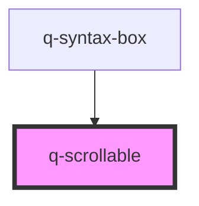

# q-scrollable

<!-- Auto Generated Below -->

## Overview

Scroll container with custom or native scrollbar styling.

## Properties

| Property         | Attribute          | Description                                                                                      | Type                   | Default    |
| ---------------- | ------------------ | ------------------------------------------------------------------------------------------------ | ---------------------- | ---------- |
| `autoHide`       | `auto-hide`        | Hides the custom scrollbar until hover, scroll, or drag activity.                                | `boolean`              | `true`     |
| `height`         | `height`           | CSS height applied to the scrollable host.                                                       | `string`               | `'100%'`   |
| `maxHeight`      | `max-height`       | Optional max-height applied to the scrollable host.                                              | `string`               | `''`       |
| `mode`           | `mode`             | Scrollbar rendering mode. Custom renders WebQuark's own thumb; native styles browser scrollbars. | `"custom" \| "native"` | `'custom'` |
| `nativeOnMobile` | `native-on-mobile` | Uses native scrollbars on coarse pointer devices when true.                                      | `boolean`              | `true`     |
| `target`         | `target`           | CSS selector for an external native-scroll target resolved from this component's root node.      | `string`               | `''`       |

## Events

| Event     | Description                        | Type                                  |
| --------- | ---------------------------------- | ------------------------------------- |
| `qScroll` | Emitted when the viewport scrolls. | `CustomEvent<QScrollableEventDetail>` |

## Methods

### `scrollToBottom() => Promise<void>`

Moves the viewport to its maximum vertical scroll position.

#### Returns

Type: `Promise<void>`

### `scrollToPosition(top: number) => Promise<void>`

Moves the viewport to a specific vertical scroll position.

#### Parameters

| Name  | Type     | Description |
| ----- | -------- | ----------- |
| `top` | `number` |             |

#### Returns

Type: `Promise<void>`

## Slots

| Slot | Description                                      |
| ---- | ------------------------------------------------ |
|      | Content rendered inside the scrollable viewport. |

## Shadow Parts

| Part         | Description                          |
| ------------ | ------------------------------------ |
| `"content"`  | Content wrapper inside the viewport. |
| `"thumb"`    | Custom scrollbar thumb.              |
| `"track"`    | Custom scrollbar track.              |
| `"viewport"` | Scrollable viewport element.         |

## Dependencies

### Used by

 - [q-syntax-box](../../data-display/syntax-box)

### Graph

----------------------------------------------

*Built with [StencilJS](https://stenciljs.com/)*
