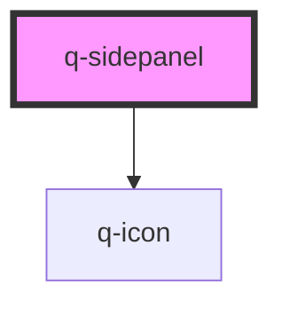

# q-sidepanel

In `nav` and `panel` variants, set `collapsible` to enable a collapsed state (`rail` or `hidden` via `collapse-mode`) that consumers can drive externally through the `collapsed` prop, or with a built-in toggle placed using `collapse-control` (`header`, `footer`, or `edge`).

Use `collapse-control-appearance="icon-button"` for the standard square control or `collapse-control-appearance="edge-tab"` for an attached edge handle. `collapse-control-position` accepts a CSS length or percentage and measures from the top for left/right sidepanels, or from the left for top/bottom sidepanels.

Use the `collapse-control-adornment` slot for a visual notification badge or label. It straddles the control's top-left corner by default; keep `collapse-label` synchronized with meaningful adornment content for assistive technology.

<!-- Auto Generated Below -->

## Overview

Drawer, persistent panel, or hierarchical navigation side panel.

## Properties

| Property                    | Attribute                     | Description                                                                  | Type                                       | Default            |
| --------------------------- | ----------------------------- | ---------------------------------------------------------------------------- | ------------------------------------------ | ------------------ |
| `accordion`                 | `accordion`                   | Opening one group collapses its siblings.                                    | `boolean`                                  | `false`            |
| `ariaLabel`                 | `aria-label`                  | Accessible name for the rendered navigation, panel, or drawer region.        | `string`                                   | `null`             |
| `collapseControl`           | `collapse-control`            | `none` delegates the collapse control and `collapsed` state to the consumer. | `"edge" \| "footer" \| "header" \| "none"` | `'none'`           |
| `collapseControlAppearance` | `collapse-control-appearance` | `edge-tab` is intended for `collapse-control="edge"`.                        | `"edge-tab" \| "icon-button"`              | `'icon-button'`    |
| `collapseControlPosition`   | `collapse-control-position`   | Measured from the top on vertical sides and left on horizontal sides.        | `string`                                   | `''`               |
| `collapseLabel`             | `collapse-label`              | Accessible label for the built-in collapse control.                          | `string`                                   | `'Toggle sidebar'` |
| `collapseMode`              | `collapse-mode`               | `rail` keeps an icon rail; `hidden` collapses to near-zero size.             | `"hidden" \| "rail"`                       | `'rail'`           |
| `collapsed`                 | `collapsed`                   | Updated by either the built-in control or external property binding.         | `boolean`                                  | `false`            |
| `collapsible`               | `collapsible`                 | Enables collapse behavior for nav and panel variants.                        | `boolean`                                  | `false`            |
| `expanded`                  | `expanded`                    |                                                                              | `boolean`                                  | `true`             |
| `items`                     | --                            | Navigation items rendered in nav mode.                                       | `SidepanelItemInput[]`                     | `[]`               |
| `mode`                      | `mode`                        | Displays items as a flat list, one-level groups, or a deep tree.             | `"flat" \| "grouped" \| "tree"`            | `'flat'`           |
| `open`                      | `open`                        | Controls drawer visibility when variant="drawer".                            | `boolean`                                  | `false`            |
| `panelSize`                 | `panel-size`                  | Drawer width or height, depending on `side`.                                 | `string`                                   | `'320px'`          |
| `side`                      | `side`                        |                                                                              | `"bottom" \| "left" \| "right" \| "top"`   | `'right'`          |
| `value`                     | `value`                       | Active leaf item value.                                                      | `string`                                   | `''`               |
| `variant`                   | `variant`                     | Selects a drawer overlay, navigation sidebar, or persistent slotted panel.   | `"drawer" \| "nav" \| "panel"`             | `'nav'`            |

## Events

| Event              | Description                                                       | Type                                           |
| ------------------ | ----------------------------------------------------------------- | ---------------------------------------------- |
| `qClose`           | Emitted when the drawer is requested to close.                    | `CustomEvent<void>`                            |
| `qCollapsedChange` | Emitted only when the built-in control changes `collapsed`.       | `CustomEvent<QSidepanelCollapsedChangeDetail>` |
| `qSelect`          | Emitted only for leaf items; parent activation toggles the group. | `CustomEvent<QSidepanelSelectDetail>`          |

## Slots

| Slot                           | Description                                                                                          |
| ------------------------------ | ---------------------------------------------------------------------------------------------------- |
|                                | Main content used by drawer and panel variants.                                                      |
| `"collapse-control-adornment"` | Optional notification badge or visible label positioned over the built-in control's top-left corner. |
| `"collapse-icon"`              | Optional icon shown by the built-in control while the sidepanel is expanded.                         |
| `"expand-icon"`                | Optional icon shown by the built-in control while the sidepanel is collapsed.                        |
| `"footer"`                     | Footer content for all variants.                                                                     |
| `"header"`                     | Header content for all variants.                                                                     |

## Shadow Parts

| Part                           | Description                                                               |
| ------------------------------ | ------------------------------------------------------------------------- |
| `"backdrop"`                   | Drawer backdrop click target.                                             |
| `"body"`                       | Body or navigation region.                                                |
| `"collapse-control"`           | Built-in collapse button.                                                 |
| `"collapse-control-adornment"` | Positioning wrapper for the built-in control's optional visual adornment. |
| `"drawer"`                     | Drawer dialog surface.                                                    |
| `"footer"`                     | Footer region.                                                            |
| `"header"`                     | Header region.                                                            |
| `"item-badge"`                 | Navigation item's optional count badge.                                   |
| `"panel"`                      | Persistent panel surface.                                                 |

## Dependencies

### Depends on

- [q-icon](../../media/icon)

### Graph

----------------------------------------------

*Built with [StencilJS](https://stenciljs.com/)*
