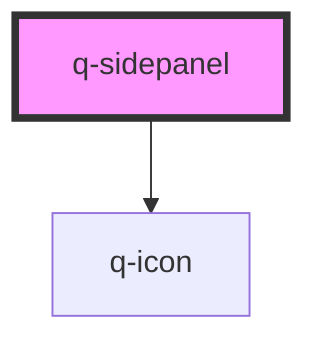

# q-sidepanel

In `nav` variant, set `collapsible` to enable a collapsed state (`rail` or `hidden` via `collapse-mode`) that consumers can drive externally through the `collapsed` prop, or via a built-in toggle button placed with `collapse-control` (`header`, `footer`, or `edge`).

<!-- Auto Generated Below -->

## Overview

Drawer, persistent panel, or hierarchical navigation side panel.

## Properties

| Property          | Attribute          | Description                                                                                                                                                                                                                                                     | Type                                       | Default            |
| ----------------- | ------------------ | --------------------------------------------------------------------------------------------------------------------------------------------------------------------------------------------------------------------------------------------------------------- | ------------------------------------------ | ------------------ |
| `accordion`       | `accordion`        | If true, opening one group collapses all sibling groups                                                                                                                                                                                                         | `boolean`                                  | `false`            |
| `ariaLabel`       | `aria-label`       | Accessible name for the rendered navigation, panel, or drawer region.                                                                                                                                                                                           | `string`                                   | `null`             |
| `collapseControl` | `collapse-control` | Where to render the built-in collapse toggle button. 'none' means the consumer supplies their own control and drives `collapsed` externally.                                                                                                                    | `"edge" \| "footer" \| "header" \| "none"` | `'none'`           |
| `collapseLabel`   | `collapse-label`   | Accessible label override for the built-in collapse control (aria-label/title).                                                                                                                                                                                 | `string`                                   | `'Toggle sidebar'` |
| `collapseMode`    | `collapse-mode`    | Visual behavior while collapsed: 'rail' shrinks to an icon-only rail, 'hidden' collapses to near-zero width. Reflected so light-DOM consumers can style slotted header/footer content differently per mode (e.g. q-sidepanel[collapsed][collapse-mode="rail"]). | `"hidden" \| "rail"`                       | `'rail'`           |
| `collapsed`       | `collapsed`        | Current collapsed state. Reflected + mutable: the component's own built-in control can flip it directly (same pattern as q-toggle's `checked`), while consumers can also drive it externally via property binding.                                              | `boolean`                                  | `false`            |
| `collapsible`     | `collapsible`      | Enables the collapse feature. Only takes effect when variant="nav". Reflected so host-level width CSS (e.g. the collapsed/rail width rule) can be gated on it, keeping it in sync with the inner is-collapsed/collapse-mode-* classes applied in render().      | `boolean`                                  | `false`            |
| `expanded`        | `expanded`         |                                                                                                                                                                                                                                                                 | `boolean`                                  | `true`             |
| `items`           | --                 | Navigation items rendered in nav mode.                                                                                                                                                                                                                          | `SidepanelItemInput[]`                     | `[]`               |
| `mode`            | `mode`             | Item display mode: flat list, one-level groups, or deep tree                                                                                                                                                                                                    | `"flat" \| "grouped" \| "tree"`            | `'flat'`           |
| `open`            | `open`             | Controls drawer visibility when variant="drawer".                                                                                                                                                                                                               | `boolean`                                  | `false`            |
| `panelSize`       | `panel-size`       | Width or height depending on `side` (drawer mode only)                                                                                                                                                                                                          | `string`                                   | `'320px'`          |
| `side`            | `side`             | Edge the drawer opens from.                                                                                                                                                                                                                                     | `"bottom" \| "left" \| "right" \| "top"`   | `'right'`          |
| `value`           | `value`            | Active leaf item value.                                                                                                                                                                                                                                         | `string`                                   | `''`               |
| `variant`         | `variant`          | 'drawer' = slide-in overlay, 'nav' = fixed navigation sidebar, 'panel' = persistent slotted side panel                                                                                                                                                          | `"drawer" \| "nav" \| "panel"`             | `'nav'`            |

## Events

| Event              | Description                                                                                                                           | Type                                           |
| ------------------ | ------------------------------------------------------------------------------------------------------------------------------------- | ---------------------------------------------- |
| `qClose`           | Emitted when the drawer is requested to close.                                                                                        | `CustomEvent<void>`                            |
| `qCollapsedChange` | Fires whenever the BUILT-IN collapse control toggles collapsed. Does not fire when a consumer sets [collapsed] externally themselves. | `CustomEvent<QSidepanelCollapsedChangeDetail>` |
| `qSelect`          | Fires only for leaf items; clicking a parent group toggles it instead                                                                 | `CustomEvent<QSidepanelSelectDetail>`          |

## Slots

| Slot       | Description                                     |
| ---------- | ----------------------------------------------- |
|            | Main content used by drawer and panel variants. |
| `"footer"` | Footer content for all variants.                |
| `"header"` | Header content for all variants.                |

## Shadow Parts

| Part                 | Description                          |
| -------------------- | ------------------------------------ |
| `"backdrop"`         | Drawer backdrop click target.        |
| `"body"`             | Body or navigation region.           |
| `"collapse-control"` | Built-in navigation collapse button. |
| `"drawer"`           | Drawer dialog surface.               |
| `"footer"`           | Footer region.                       |
| `"header"`           | Header region.                       |
| `"panel"`            | Persistent panel surface.            |

## Dependencies

### Depends on

- [q-icon](../../media/icon)

### Graph

----------------------------------------------

*Built with [StencilJS](https://stenciljs.com/)*
