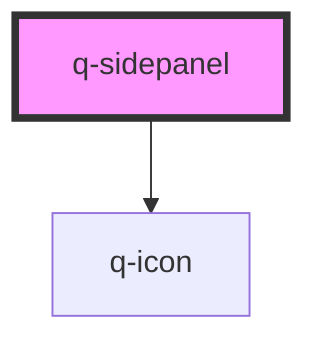

# q-sidepanel

<!-- Auto Generated Below -->

## Properties

| Property    | Attribute    | Description                                                   | Type                                     | Default   |
| ----------- | ------------ | ------------------------------------------------------------- | ---------------------------------------- | --------- |
| `accordion` | `accordion`  | If true, opening one group collapses all sibling groups       | `boolean`                                | `false`   |
| `expanded`  | `expanded`   |                                                               | `boolean`                                | `true`    |
| `items`     | --           |                                                               | `SidepanelItem[]`                        | `[]`      |
| `mode`      | `mode`       | Item display mode: flat list, one-level groups, or deep tree  | `"flat" \| "grouped" \| "tree"`          | `'flat'`  |
| `open`      | `open`       |                                                               | `boolean`                                | `false`   |
| `panelSize` | `panel-size` | Width or height depending on `side` (drawer mode only)        | `string`                                 | `'320px'` |
| `side`      | `side`       |                                                               | `"bottom" \| "left" \| "right" \| "top"` | `'right'` |
| `value`     | `value`      |                                                               | `string`                                 | `''`      |
| `variant`   | `variant`    | 'drawer' = slide-in overlay, 'nav' = fixed navigation sidebar | `"drawer" \| "nav"`                      | `'nav'`   |

## Events

| Event     | Description                                                           | Type                                  |
| --------- | --------------------------------------------------------------------- | ------------------------------------- |
| `qClose`  |                                                                       | `CustomEvent<void>`                   |
| `qSelect` | Fires only for leaf items; clicking a parent group toggles it instead | `CustomEvent<QSidepanelSelectDetail>` |

## Shadow Parts

| Part         | Description |
| ------------ | ----------- |
| `"backdrop"` |             |
| `"body"`     |             |
| `"drawer"`   |             |
| `"footer"`   |             |
| `"header"`   |             |

## Dependencies

### Depends on

- [q-icon](../../media/icon)

### Graph

----------------------------------------------

*Built with [StencilJS](https://stenciljs.com/)*
