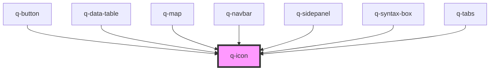

# q-icon

<!-- Auto Generated Below -->

## Overview

Remote, local, or binary icon renderer with SVG sanitization.

## Properties

| Property       | Attribute       | Description                                                                             | Type                                                                    | Default            |
| -------------- | --------------- | --------------------------------------------------------------------------------------- | ----------------------------------------------------------------------- | ------------------ |
| `color`        | `color`         |                                                                                         | `"currentColor" \| string & {}`                                         | `'currentColor'`   |
| `fetchTimeout` | `fetch-timeout` | SVG fetch timeout in milliseconds.                                                      | `number`                                                                | `8000`             |
| `label`        | `label`         | Meaningful icons require a label; unlabeled icons are hidden from assistive technology. | `string`                                                                | `undefined`        |
| `lib`          | `lib`           | Supports built-in libraries, local assets, and custom URL templates.                    | `"font-awesome" \| "fontawesome" \| "local" \| "lucide" \| string & {}` | `'lucide'`         |
| `libVersion`   | `lib-version`   | Overrides the version of built-in remote libraries.                                     | `string`                                                                | `undefined`        |
| `localPath`    | `local-path`    | Base path used when `lib="local"`.                                                      | `string`                                                                | `'/assets/icons/'` |
| `name`         | `name`          | Icon name or local asset filename.                                                      | `string`                                                                | `undefined`        |
| `size`         | `size`          | Accepts a preset, pixel number, or CSS size.                                            | `"lg" \| "md" \| "sm" \| number \| string & {}`                         | `'md'`             |

## Shadow Parts

| Part         | Description                                    |
| ------------ | ---------------------------------------------- |
| `"fallback"` | Error fallback shown when an icon cannot load. |
| `"image"`    | Native image used for binary icon assets.      |
| `"svg"`      | Container for a sanitized inline SVG.          |

## Dependencies

### Used by

 - [q-button](../../actions/button)
 - [q-data-table](../../data-display/data-table)
 - [q-map](../../data-display/map)
 - [q-navbar](../../layout/navbar)
 - [q-sidepanel](../../layout/sidepanel)
 - [q-syntax-box](../../data-display/syntax-box)
 - [q-tabs](../../layout/tabs)

### Graph

----------------------------------------------

*Built with [StencilJS](https://stenciljs.com/)*
