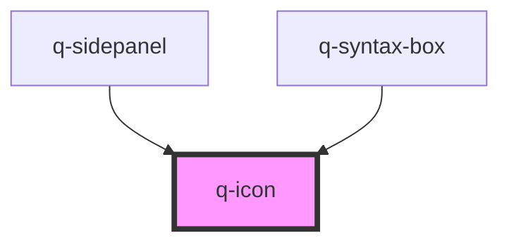

# q-icon

<!-- Auto Generated Below -->

## Properties

| Property    | Attribute    | Description                                                                                                                       | Type     | Default            |
| ----------- | ------------ | --------------------------------------------------------------------------------------------------------------------------------- | -------- | ------------------ |
| `color`     | `color`      | The color of the icon. Defaults to 'currentColor'.                                                                                | `string` | `'currentColor'`   |
| `lib`       | `lib`        | The library to load the icon from. Options: 'lucide', 'font-awesome', 'local', or a custom base URL / template URL.               | `string` | `'lucide'`         |
| `localPath` | `local-path` | The default path for local assets when `lib` is set to 'local'.                                                                   | `string` | `'/assets/icons/'` |
| `name`      | `name`       | The name of the icon (e.g., 'settings', 'heart', or a filename like 'logo.png').                                                  | `string` | `undefined`        |
| `size`      | `size`       | The size of the icon. Can be a preset alias ('sm', 'md', 'lg'), a number (pixels), or any valid CSS size string (e.g., '1.5rem'). | `string` | `'md'`             |

## Dependencies

### Used by

 - [q-sidepanel](../../layout/sidepanel)
 - [q-syntax-box](../../data-display/syntax-box)

### Graph

----------------------------------------------

*Built with [StencilJS](https://stenciljs.com/)*
