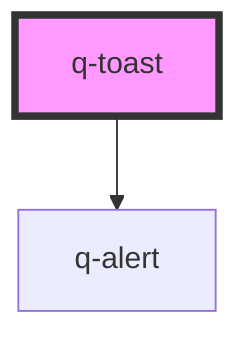

# q-toast

<!-- Auto Generated Below -->

## Overview

Global viewport toast host. Add exactly one instance near the application root,
then use the framework-neutral `toast` controller or the component methods.

## Properties

| Property     | Attribute     | Description | Type                                                                                            | Default     |
| ------------ | ------------- | ----------- | ----------------------------------------------------------------------------------------------- | ----------- |
| `maxVisible` | `max-visible` |             | `number`                                                                                        | `3`         |
| `position`   | `position`    |             | `"bottom-center" \| "bottom-end" \| "bottom-start" \| "top-center" \| "top-end" \| "top-start"` | `'top-end'` |

## Methods

### `clear() => Promise<number>`

#### Returns

Type: `Promise<number>`

### `danger(title: string, description?: string, options?: QToastOptions) => Promise<QToastId>`

#### Parameters

| Name          | Type            | Description |
| ------------- | --------------- | ----------- |
| `title`       | `string`        |             |
| `description` | `string`        |             |
| `options`     | `QToastOptions` |             |

#### Returns

Type: `Promise<string>`

### `dismiss(id: QToastId) => Promise<boolean>`

#### Parameters

| Name | Type     | Description |
| ---- | -------- | ----------- |
| `id` | `string` |             |

#### Returns

Type: `Promise<boolean>`

### `error(title: string, description?: string, options?: QToastOptions) => Promise<QToastId>`

#### Parameters

| Name          | Type            | Description |
| ------------- | --------------- | ----------- |
| `title`       | `string`        |             |
| `description` | `string`        |             |
| `options`     | `QToastOptions` |             |

#### Returns

Type: `Promise<string>`

### `info(title: string, description?: string, options?: QToastOptions) => Promise<QToastId>`

#### Parameters

| Name          | Type            | Description |
| ------------- | --------------- | ----------- |
| `title`       | `string`        |             |
| `description` | `string`        |             |
| `options`     | `QToastOptions` |             |

#### Returns

Type: `Promise<string>`

### `success(title: string, description?: string, options?: QToastOptions) => Promise<QToastId>`

#### Parameters

| Name          | Type            | Description |
| ------------- | --------------- | ----------- |
| `title`       | `string`        |             |
| `description` | `string`        |             |
| `options`     | `QToastOptions` |             |

#### Returns

Type: `Promise<string>`

### `warning(title: string, description?: string, options?: QToastOptions) => Promise<QToastId>`

#### Parameters

| Name          | Type            | Description |
| ------------- | --------------- | ----------- |
| `title`       | `string`        |             |
| `description` | `string`        |             |
| `options`     | `QToastOptions` |             |

#### Returns

Type: `Promise<string>`

## Shadow Parts

| Part             | Description                    |
| ---------------- | ------------------------------ |
| `"announcement"` | The shared polite live region. |
| `"item"`         | A visible toast wrapper.       |
| `"stack"`        | The visible toast stack.       |

## Dependencies

### Depends on

- [q-alert](../../data-display/alert)

### Graph

----------------------------------------------

*Built with [StencilJS](https://stenciljs.com/)*
