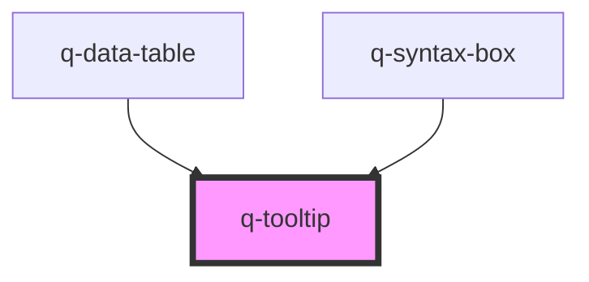

# q-tooltip

<!-- Auto Generated Below -->

## Overview

Non-interactive tooltip attached to its immediate parent element.

## Properties

| Property   | Attribute  | Description                                                                                                     | Type                                     | Default     |
| ---------- | ---------- | --------------------------------------------------------------------------------------------------------------- | ---------------------------------------- | ----------- |
| `content`  | `content`  | The text content to display inside the tooltip.                                                                 | `string`                                 | `undefined` |
| `delay`    | `delay`    | The delay in milliseconds before the tooltip shows up.                                                          | `number`                                 | `200`       |
| `position` | `position` | The placement position of the tooltip relative to its trigger parent. Options: 'top', 'bottom', 'left', 'right' | `"bottom" \| "left" \| "right" \| "top"` | `'top'`     |

## Slots

| Slot | Description                                          |
| ---- | ---------------------------------------------------- |
|      | Tooltip content used when `content` is not supplied. |

## Dependencies

### Used by

 - [q-data-table](../../data-display/data-table)
 - [q-syntax-box](../../data-display/syntax-box)

### Graph

----------------------------------------------

*Built with [StencilJS](https://stenciljs.com/)*
