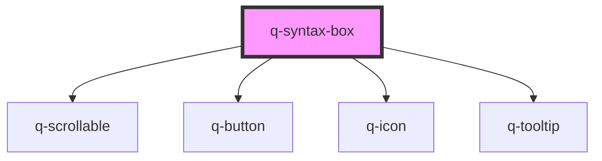

# q-syntax-box

<!-- Auto Generated Below -->

## Properties

| Property   | Attribute  | Description | Type                                        | Default     |
| ---------- | ---------- | ----------- | ------------------------------------------- | ----------- |
| `code`     | `code`     |             | `string`                                    | `undefined` |
| `copyable` | `copyable` |             | `boolean`                                   | `false`     |
| `heading`  | `heading`  |             | `string`                                    | `undefined` |
| `height`   | `height`   |             | `string`                                    | `undefined` |
| `language` | `language` |             | `"css" \| "html" \| "javascript" \| "json"` | `'html'`    |
| `variant`  | `variant`  |             | `"panel" \| "plain"`                        | `'panel'`   |

## Methods

### `scrollToBottom() => Promise<void>`

#### Returns

Type: `Promise<void>`

## Dependencies

### Depends on

- [q-scrollable](../q-scrollable)
- [q-button](../q-button)
- [q-icon](../q-icon)
- [q-tooltip](../q-tooltip)

### Graph

----------------------------------------------

*Built with [StencilJS](https://stenciljs.com/)*
