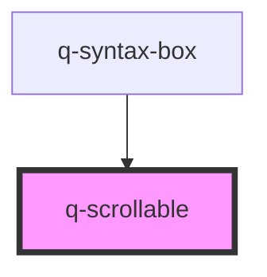

# q-scrollable

<!-- Auto Generated Below -->

## Properties

| Property         | Attribute          | Description | Type                   | Default    |
| ---------------- | ------------------ | ----------- | ---------------------- | ---------- |
| `autoHide`       | `auto-hide`        |             | `boolean`              | `true`     |
| `height`         | `height`           |             | `string`               | `'100%'`   |
| `maxHeight`      | `max-height`       |             | `string`               | `''`       |
| `mode`           | `mode`             |             | `"custom" \| "native"` | `'custom'` |
| `nativeOnMobile` | `native-on-mobile` |             | `boolean`              | `true`     |
| `target`         | `target`           |             | `string`               | `''`       |

## Events

| Event     | Description | Type                                  |
| --------- | ----------- | ------------------------------------- |
| `qScroll` |             | `CustomEvent<QScrollableEventDetail>` |

## Methods

### `scrollToBottom() => Promise<void>`

#### Returns

Type: `Promise<void>`

### `scrollToPosition(top: number) => Promise<void>`

#### Parameters

| Name  | Type     | Description |
| ----- | -------- | ----------- |
| `top` | `number` |             |

#### Returns

Type: `Promise<void>`

## Dependencies

### Used by

 - [q-syntax-box](../syntax-box)

### Graph

----------------------------------------------

*Built with [StencilJS](https://stenciljs.com/)*
