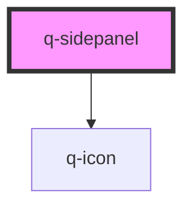

# q-sidepanel

<!-- Auto Generated Below -->

## Properties

| Property    | Attribute    | Description                                                                     | Type                                     | Default   |
| ----------- | ------------ | ------------------------------------------------------------------------------- | ---------------------------------------- | --------- |
| `accordion` | `accordion`  | If true, opening one group collapses all sibling groups (nav mode only)         | `boolean`                                | `false`   |
| `expanded`  | `expanded`   | Whether all parent groups start expanded on first render (nav mode only)        | `boolean`                                | `true`    |
| `items`     | --           | Navigation item tree passed programmatically (nav mode only)                    | `SidepanelItem[]`                        | `[]`      |
| `mode`      | `mode`       | Display mode for items: flat list, one-level groups, or deep tree               | `"flat" \| "grouped" \| "tree"`          | `'flat'`  |
| `open`      | `open`       | Controls drawer open/close state (drawer mode only)                             | `boolean`                                | `false`   |
| `panelSize` | `panel-size` | Panel dimension – width or height depending on side (drawer mode only)          | `string`                                 | `'320px'` |
| `side`      | `side`       | Screen edge the drawer slides from (drawer mode only)                           | `"bottom" \| "left" \| "right" \| "top"` | `'right'` |
| `value`     | `value`      | Value of the currently active/selected item (nav mode only)                     | `string`                                 | `''`      |
| `variant`   | `variant`    | Selects behavior: 'drawer' = slide-in overlay, 'nav' = fixed navigation sidebar | `"drawer" \| "nav"`                      | `'nav'`   |

## Events

| Event     | Description                                             | Type                                  |
| --------- | ------------------------------------------------------- | ------------------------------------- |
| `qClose`  | Fires when the drawer is closed (drawer mode)           | `CustomEvent<void>`                   |
| `qSelect` | Fires when a leaf navigation item is clicked (nav mode) | `CustomEvent<QSidepanelSelectDetail>` |

## Shadow Parts

| Part         | Description |
| ------------ | ----------- |
| `"backdrop"` |             |
| `"body"`     |             |
| `"drawer"`   |             |
| `"footer"`   |             |
| `"header"`   |             |

## Dependencies

### Depends on

- [q-icon](../icon)

### Graph

----------------------------------------------

*Built with [StencilJS](https://stenciljs.com/)*
